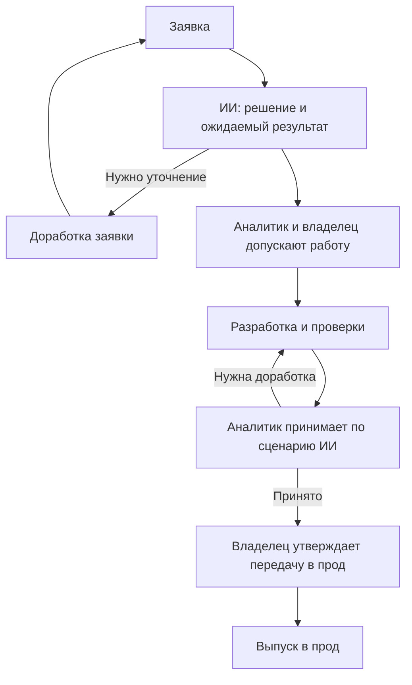
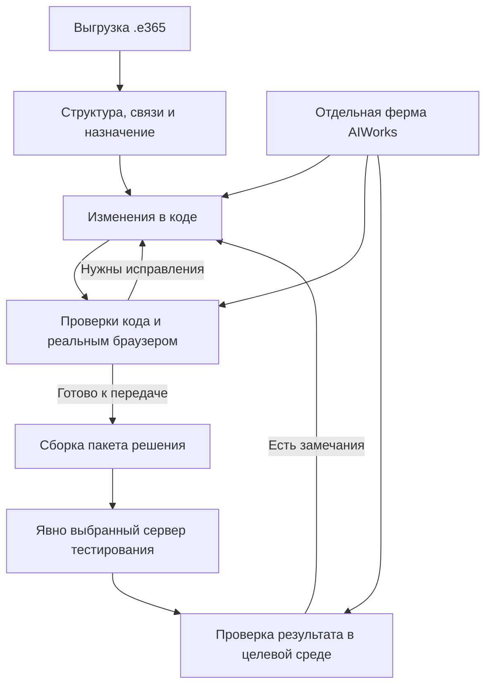

# Как задача проходит до выпуска

Актуальное описание процесса по уточнению владельца от 1 ноября 2026. Это источник для переработки раздела «Как работает» и объяснения состава решения. Полный рабочий цикл, включая выпуск в прод, работает.

## Короткое объяснение для посетителя

Мы связываем просьбу человека с устройством ELMA, готовим решение и доводим изменение до выпуска. ИИ разбирает заявку, предлагает способ решения и ожидаемый результат. Живой аналитик согласует решение, владелец продукта подтверждает необходимость работы. После разработки аналитик принимает результат по подготовленному ИИ сценарию, затем утверждается передача в прод.

## Кто принимает решения

До разработки нужны два разных решения:

- Аналитик согласен с пониманием задачи, предлагаемым решением и ожидаемым результатом.
- Владелец продукта подтверждает, что эту работу нужно выполнять.

Предложение ИИ само по себе не отправляет задачу в разработку. Если понимания недостаточно, заявка возвращается на уточнение или доработку с конкретными вопросами.

После выполнения аналитик принимает конкретный результат по сценарию, который подготовил ИИ. Замечания возвращают работу на доработку. Приемка аналитика и утверждение передачи в прод - отдельные человеческие решения. Роль утверждения передачи закреплена за владельцем продукта в действующей модели приемки.

## Как технически выполняется изменение

1. Выгружаем решение в файл `.e365` и раскладываем его на структуру: формы, процессы, код и связи. Объясняем назначение элементов и их связь с задачей человека.
2. Изменения кода выполняем в коде разобранного решения. Сохраняем связь изменения с исходной заявкой и требованиями.
3. Ферма AIWorks выполняет задания и проверки. Там, где нужна визуальная валидация, отдельный браузерный исполнитель открывает приложение, делает реальные клики и оценивает фактическое состояние интерфейса.
4. Упаковываем подготовленное изменение в решение для передачи.
5. Передаем пакет на явно выбранный следующий сервер, где нужно тестировать конкретное изменение. На схеме не подставляем автоматически DEV2 и не превращаем этот шаг в безусловную передачу сразу в прод.
6. Проверяем результат в целевой среде. Визуальная проверка может потребоваться и здесь. Далее результат проходит человеческую приемку и утверждение передачи в прод по первой схеме.

## Компоненты сохраняют отдельные роли

| Компонент | Что делает |
| --- | --- |
| Рабочее пространство | Контекст модулей и элементов, заявки, согласованное решение, ход работы, доказательства и решения людей |
| Отдельная ферма AIWorks | Исполнение заданий, изменения кода, технические проверки, визуальный обход и проверка реальным браузером |
| ELMA и связанные системы | Исходное устройство, тестирование и применение изменений на конкретных серверах |

## Как разместить на сайте

После короткого объяснения и реального кейса дать раздел «Как проходит изменение». В нем два отдельных слоя: решения людей и техническое выполнение. На главной можно показать короткую выдержку; подробный путь `.e365` и работу браузерных исполнителей раскрыть в этом разделе.

Не смешивать первичное понимание заявки, допуск в разработку, техническую проверку, приемку аналитика и утверждение передачи в прод в один статус «готово». Показать, кто делает следующий шаг и какое решение от него требуется.

## Реальные цифры

Данные предоставит владелец по [заявке 13](https://github.com/netbka/elma_wiki_public/issues/13). Первая сводка нужна по модулям. Число форм и процессов - полезное дополнение; полный перечень всех полей и операций для этой задачи не требуется. Доступ к HomePc для сбора прекращен.
