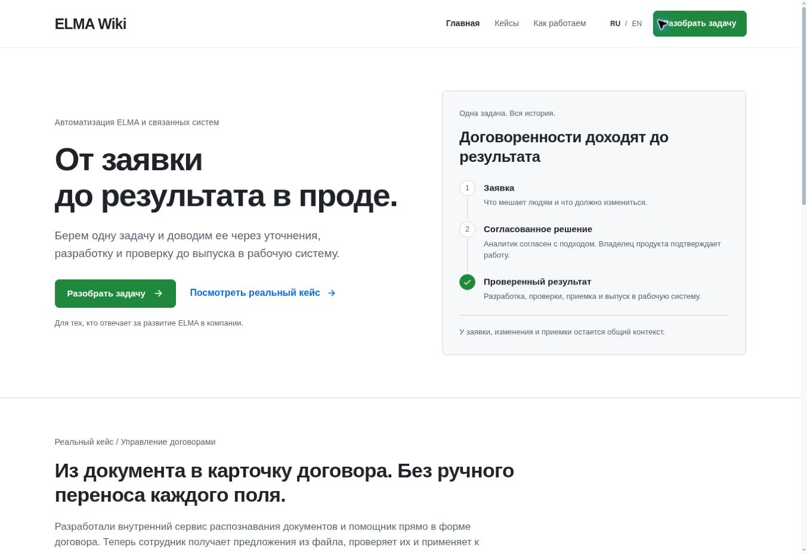
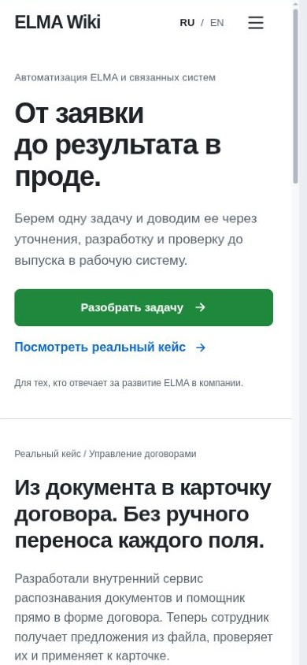
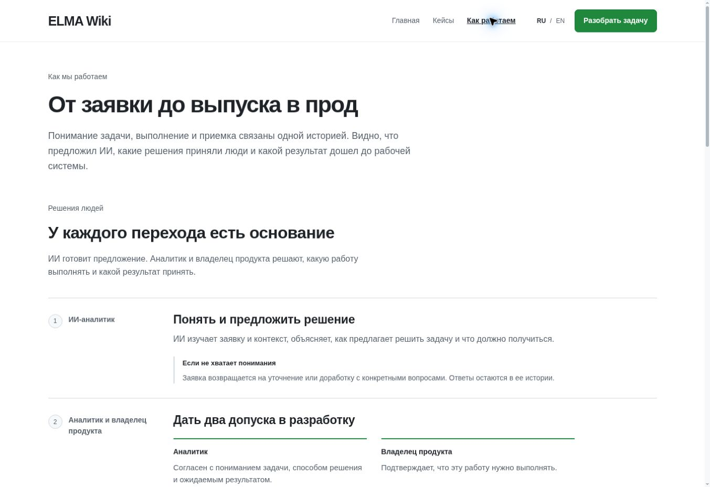

# Проверка реализации согласованной подачи

## Что изменено

Главный путь: короткое объяснение -> реальный кейс -> процесс работы -> разбор одной задачи. Основной посетитель отвечает за развитие ELMA у заказчика. Главная и кейсы показывают проектную работу до выпуска; учебные инструменты доступны отдельно.

Реализованы кейс помощника заполнения договора из файла и короткий кейс исключения повторного согласования. Схемы объясняют факты реализации; рабочих документов, клиентов и вымышленных показателей нет. Название продукта сохранено до выбора владельца. Реальные агрегаты ожидаются в issue #13.

## Статические и проектные проверки

- `npm run build` прошла; обязательные файлы сборки сформированы.
- `npm run test:sites`: 4 проверки прошли.
- `npm run test:workspace`: 7 проверок прошли.
- Frontend Design Premium, strict audit: 0 замечаний.
- `designmd lint DESIGN.md`: 0 ошибок и предупреждений.
- Независимый просмотр интеграции проверил роли, отдельную ферму, реальные кейсы и вторичные маршруты. Найденная проблема перевода ошибок формы исправлена и проверена в браузере.

## Проверка в браузере

Использован cloud Chromium. Desktop проверен в полной вкладке. Ширины 320, 390 и 768 px проверены через временный same-origin iframe с соответствующей шириной viewport. Это проверка адаптивного отображения в Chromium, а не испытание на физическом iPhone/Safari. Временная страница проверки удалена из проекта.

- Главная, кейсы и процесс: горизонтального переполнения на проверенных узких ширинах нет.
- На телефоне после короткой вводной сразу начинается кейс; повторяющееся резюме пути из desktop-hero скрыто.
- RU/EN: заголовки, пояснения и видимые ошибки формы меняют язык.
- Контакт: пустые поля дают связанные текстовые ошибки и фокус на email; корректные данные открывают явно обозначенный неотправленный черновик; редактирование сохраняет текст.
- Мобильное меню открывается, закрывается по Escape с возвратом фокуса и закрывается после перехода.
- Нативное раскрытие состава решения открывается клавишей Enter.
- Сохранены входы в учебные модули, заявки, приемку, возможности, команду и раздел об авторе; страницы получают правильные заголовки.
- Учебное пространство явно говорит о локальных вымышленных данных. Изменения объяснительных страниц не запускают ELMA, AIWorks или отправку писем.

## Сверка оформления

Исходный первый экран и новая desktop-версия просмотрены вместе. Это переработка согласованной истории в существующем оформлении.

| Правило | Результат |
| --- | --- |
| Белый фон, Primer-палитра, системный шрифт | Сохранены |
| Плоские поверхности, общие кнопки и видимый фокус | Сохранены |
| Токены в src/styles.css | Новые секции используют существующие CSS variables |
| Короткое объяснение и кейс | Реализованы; на телефоне кейс идет непосредственно после вводной |
| Основной шаг «Разобрать задачу» | Один смысл и подпись на связанных страницах |
| Отдельная ферма AIWorks и решения людей | Показаны отдельно от исходной ELMA и технических сред |

## Сохраненные снимки

Снимки desktop сохранены напрямую из браузера и просмотрены после сохранения. Узкий снимок вырезан по границам viewport из сохраненного кадра временной страницы проверки; содержимое страницы не изменялось.

### Главная, desktop

### Главная, узкий viewport

### Процесс, desktop

Публикация Sites не обновлялась. Контактная форма сохраняет прежний режим предпросмотра без отправки.
