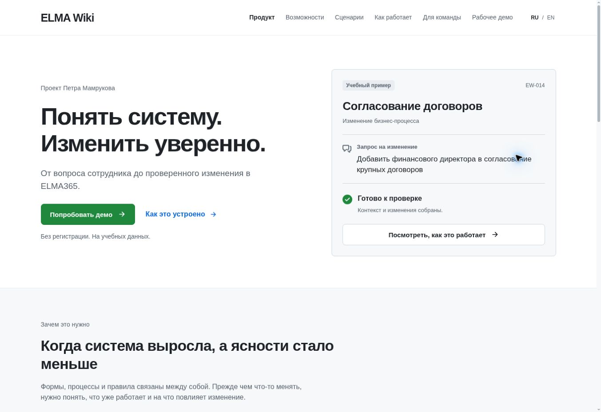
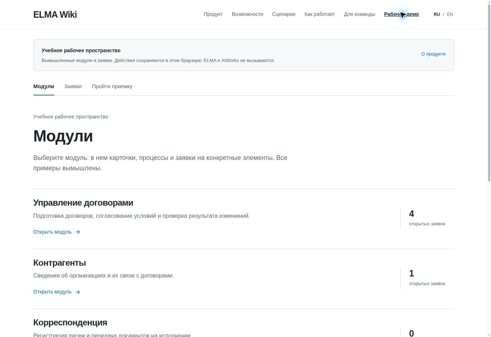
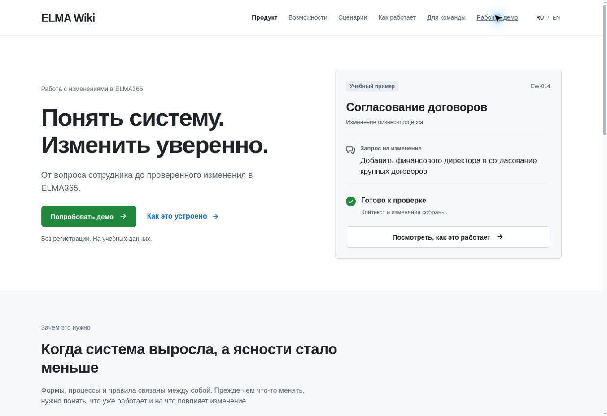

# Разбор подачи продукта

Основание: запрос владельца обсудить аудиторию, цель и главное доказательство перед дальнейшей переработкой. Это разбор текущей подачи, а не утвержденное позиционирование и не исследование внешнего спроса.

Проверена локальная сборка исходного кода из main `9b5ced00cc5891af1071c072960175dfc074c431`. Снимки сохранены напрямую из браузера и просмотрены после сохранения. Область проверки: первый экран и переход в учебные модули, desktop 1353 x 929. Полный аудит доступности и мобильных состояний в эту проверку не входит.

## Наблюдения

| Экран | Оценка подачи | Наблюдение | Следующее решение |
| --- | --- | --- | --- |
| 1. Главная до правки | Требует уточнения | Общее обещание не определяет основного посетителя и его рабочую ситуацию. Имя автора занимает место в первом экране. Основная кнопка ведет в пошаговый пример приемки, а пункт «Рабочее демо» в шапке ведет в модули | Определить одного основного посетителя, его проблему и один главный маршрут доказательства |
| 2. Учебные модули | Требует вводного сценария | Состав модулей, заявки и контекст отражены в рабочем интерфейсе. Новому посетителю не поставлена задача, по которой можно понять ценность этих связей | Решить, нужен ли сначала короткий маршрут по одной заявке, а свободное изучение оставить следующим уровнем |
| 3. Главная после узкой правки | Запрос на авторство выполнен | Имя удалено из первого экрана и отдельного авторского блока главной; авторство остается в подвале и разделе об авторе. Обещание и маршруты пока сохранены | Вернуться к ним после обсуждения основного brief |

Сильные стороны текущего оформления: спокойная типографика, читаемая иерархия, узнаваемый рабочий интерфейс, явная маркировка учебных данных. Сначала требуется выбор цели и истории, затем решение о композиции и объеме страниц.

### 1. Главная до правки

### 2. Переход в учебные модули

### 3. Главная после удаления имени

## Решения для обсуждения

1. Цель сайта: новые проекты, пилоты продукта или партнерства. Для первого прохода выбрать одну.
2. Основной посетитель: ответственный за развитие ELMA у заказчика, команда интегратора или заказчик более широкой автоматизации. Отдельно определить ежедневного пользователя.
3. Главная демонстрация: путь изменения, работа ИИ или понимание существующей системы. Не ставить все три обещания на один уровень.
4. Предложение посетителю: готовый доступ к инструменту, адаптация под конкретный процесс или совместная работа над подходом.
5. Доказательства: учебный интерактивный сценарий, запись работы или разрешенный реальный кейс. Маркировать каждый формат.
6. Формат входа: короткий управляемый маршрут, свободная рабочая среда или подробный инженерный кейс.
7. Следующее действие: обсудить один процесс, подать заявку на пилот или начать партнерский разговор.
8. Границы обещания: зрелость, роль человека, подключение данных и ответственность за внедрение.
9. Границы содержания: что обязательно для основного решения посетителя, а что можно вынести на второй уровень.
10. Критерий успеха: содержательные обращения от выбранной аудитории и подходящие обсуждения, а не только число просмотров.

Варианты остаются гипотезами до ответа владельца. Новые экраны и маркетинговые обещания в рамках этой правки не добавлены. Зарегистрированная публикация Sites не обновлялась.

## Проверка узкой правки

- Сборка `npm run build` прошла.
- Статическая проверка Frontend Design Premium в strict-режиме: 0 замечаний.
- Сохраненный снимок первого экрана просмотрен: имя отсутствует.
